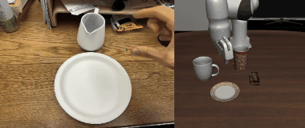
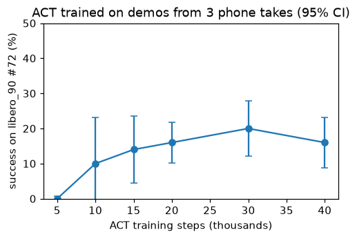
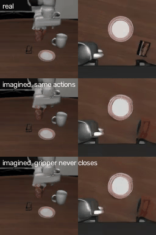
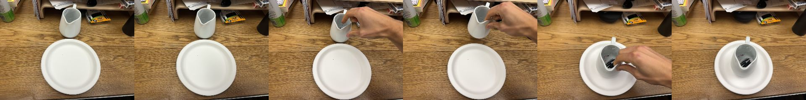
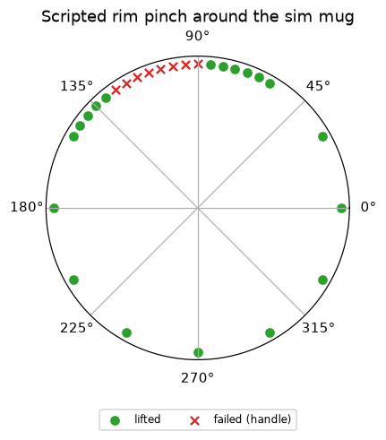

# Phone video to a Panda in LIBERO: put the mug on the plate

I recorded myself moving a white jug onto a plate with an iPhone (LiDAR depth plus phone pose). This repo turns
that recording into robot demonstrations for LIBERO task `libero_90 #72` ("put the white mug on the plate"),
multiplies them in simulation, and trains policies (ACT and the SmolVLA VLA) on nothing but that data.

**Headline:** policies trained only on demos from three phone takes put the mug on the plate in LIBERO's standard
episodes: SmolVLA 46% (52% on a retrain), ACT 41% averaged over three training seeds (64%, 36%, 24%). The same
recipes on scripted demos reach 84% and 92%, so the remaining gap is in the human-derived trajectories, and the
seed spread shows how unstable ACT is on this data. The best single run, 70%, opens the gripper 2 cm above the
plate instead of after pressing the mug down; it is one seed, so it needs repeats before it counts as a fix. A world model trained on the same demos predicts the robot's
cameras 2 s ahead and, once given no-grasp episodes, imagines that the mug moves only while held, including for a
release it never saw.



*Left: my hand, recorded in a hotel room. Right: the Panda replaying the retargeted motion. LIBERO's own success check fires.*

## Results

All success rates are LIBERO's own task check on the 50 stored start states of `libero_90 #72`, 400 steps max,
evaluated with `lerobot-eval`. 100 episodes per row unless noted; the 95% interval at 20% is about +-8 points.

| What | Data | Success |
|---|---|---|
| Open-loop replay of each phone take (own layout) | 5 takes | 3/5 takes |
| Demo multiplier yield (replay at new object positions, kept only if the sim says success) | 3 takes | 60-66% first settings, 87-91% later |
| SmolVLA `lerobot/smolvla_libero`, zero-shot (no own data) | none | 2% |
| ACT, 30k steps, 20 actions per call | 200 demos from 3 takes | 20% |
| same ACT checkpoint, 5 actions per call | 200 demos from 3 takes | 36% |
| same ACT checkpoint, temporal ensembling (1 action per call) | 200 demos from 3 takes | 36% |
| ACT, 30k steps, noisy demos (DART), 20 / 5 actions per call | 200 demos from 3 takes | 16% / 14% |
| SmolVLA fine-tuned 5k steps on noisy demos, 10 actions per call | 200 demos from 3 takes | 32% (50 episodes) |
| SmolVLA fine-tuned from `smolvla_libero`, 5k steps, 10 actions per call | 200 demos from 3 takes | 46% (48% on a first 50) |
| same, retrained from scratch to check it | 200 demos from 3 takes | 52% (50 episodes) |
| ACT, 30k steps, 5 actions per call | 400 demos from 3 takes | 34% |
| **ACT, same, with my pauses removed from the takes, 3 training seeds** | 400 demos from 3 takes | **64% / 36% / 24% (mean 41%)** |
| ACT, pauses removed, wrist held at the grasp orientation | 400 demos from 3 takes | 40% |
| ACT, pauses removed, gripper opens 2 cm above the set-down point, 10k / 30k steps | 400 demos from 3 takes | 44% / **70%** (one seed) |
| SmolVLA, same recipe, 5k steps | 400 demos from 3 takes | 0% |
| SmolVLA, same recipe, 5k / 10k steps | 400 demos, pauses removed | 0% / 1% |
| SmolVLA, same recipe, 10k steps | 400 demos, pauses removed, wrist held still | 0% (50 episodes) |
| Reference: ACT on demos from a scripted grasp (true mug pose), same multiplier and recipe, 5 actions per call | 400 scripted demos | 92% |
| Reference: SmolVLA, same recipe as the 46% row | 400 scripted demos | 84% (50 episodes) |

**SmolVLA works on one demo set and not on the next.** On the first 200-demo set it reaches 46%, and a retrain
from scratch gives 52%. On the later 400-demo sets (sampled around the mean of LIBERO's start states instead of
around one start state) it scores 0-1%, including after 10k steps: it reaches the mug, presses on it and twists
the wrist. ACT trains on those same sets (34-41%), and SmolVLA reaches 84% on scripted demos made with the same
settings, so the problem is specific to SmolVLA on the 400 demos from my takes. Another applicant hit the same
failure and traced it to the human wrist turning more than in LIBERO's demos
([andrealo20/phone-to-panda](https://github.com/andrealo20/phone-to-panda)); holding the wrist still did not fix
it here (0%). The cause is not found.

**Caveats.** Checkpoints and the number of actions per policy call were chosen on the same 50 start states the
table reports, so the best rows are optimistic. Training seeds matter more than any data change I tried: the
pauses-removed recipe gives 64%, 36% and 24% with three seeds, and the 64% checkpoint drops to 36% at 10 actions per
call and 8% with temporal ensembling. The as-recorded (34%), still-wrist (40%) and release-early (44% / 70%) rows
are single seeds, so their differences from the 41% mean may be noise. "Pauses make the policy stall" is my reading of the
failure videos, not a measured cause: retiming also made episodes shorter.

The scripted reference shows the ACT recipe can solve this task with this much data, so the gap is in the
human-derived trajectories. My hand is still 43-65% of the time in the takes (scripted: 20%), so I removed the
pauses; the first seed went from 34% to 64%, but across three seeds the mean is 41%, so the gain is uncertain.
The 64% policy's failures carry the mug over the plate and hover without letting go: my hand presses the mug onto
the plate before opening, while the scripted demos open just above it. Opening 2 cm higher (`--release-early`)
gave 44% at 10k steps and 70% at 30k, one seed; given the 24-64% seed spread above, more seeds are needed.



## World model

A learned simulator trained on the same demos (`infra/modal_world.py`). Given the robot's two camera images and its
next 4 actions, it predicts the images 0.2 s later; feeding its own predictions back imagines a whole episode.
Frames are compressed with the frozen Stable Diffusion VAE (128 px, 4x16x16 latent per camera) and a small
FiLM-conditioned conv net predicts the change, trained unrolled on its own predictions (15k steps, one H100, about
25 min). A classifier trained on real frames judges whether an imagined episode ends with the mug on the plate.



*Held-out episode, wm2. Rows: real; imagined with the demo's actions; same actions with the gripper never
closing; same actions with the gripper opening halfway through the carry.*

| Test (rules written before running) | wm1: demos only | wm2: + 300 no-grasp episodes |
|---|---|---|
| Latent error 1 s ahead vs copying the last frame | 0.032 vs 0.410 (pass) | 0.034 vs 0.415 (pass) |
| Own actions end on the plate (70%+) | 70% (pass) | 68% (fail by 2 points) |
| Gripper never closing ends on the plate (30% or less) | 47% (fail) | **0%** (pass) |
| Gripper opening mid-carry ends on the plate (30% or less); in no training episode | not tested | **28%** (pass) |
| For reference: real final frames judged "on plate" | 68% | 68% |

wm1 predicted motion well but imagined the mug following the arm even when it was never grasped: it had never seen
an open gripper during a carry. Adding 300 sim episodes that replay my tracks with the gripper never closing (the
mug stays put) fixed that, and it generalised to a release it never saw: opening mid-carry mostly ends with the
mug short of the plate. The "on plate" classifier was fixed after wm1's first evaluation (it labelled the last held
frames, mug already on the plate, as "not on plate"; first numbers 48% / 18%, real 52%). Not used to control the
robot.

## How it works

```
iPhone (Stray Scanner: RGB 1920x1440 @ 60 fps, LiDAR depth, ARKit poses)
  -> tools/scene.py        table plane, plate and jug from LiDAR (metric, gravity-aligned)
  -> tools/extract_hand.py WiLoR hand keypoints per frame, placed in 3D with the phone intrinsics + LiDAR depth
  -> tools/replay.py       thumb/index pinch -> Panda gripper pose and open/close; real -> sim transform;
                           grasp anchor; open-loop replay in LIBERO (OSC_POSE, 20 Hz)
  -> tools/retime.py       drop the frames where my hand is still (keeps the gripper dwell)
  -> tools/generate_demos.py  MimicGen-style: move mug and plate, warp the path with them, keep sim successes
                              -> LeRobotDataset (same format as the public LIBERO datasets)
  -> lerobot-train (ACT locally; ACT and SmolVLA on Modal, infra/modal_train.py)
  -> tools/eval_policy.sh  lerobot-eval on libero_90 #72, appends to outputs/results.csv
```



### Design choices, and why

- **Stay on a stock LIBERO task.** `libero_90 #72` uses a white mug and a plate, which I could reproduce with
  a hotel jug and plate. No custom scene, so the success check and start states are LIBERO's own.
- **LiDAR, not monocular depth.** The phone gives metric depth and its own pose for free. The table plane drifts
  0.14-0.30 cm over a take (test S2); the plate measures 23 cm, which matches a tape measure.
- **Hand to gripper.** WiLoR gives 21 hand keypoints. The gripper frame comes from the knuckles (stable while
  pinching), the gripper point is the thumb/index tip midpoint, and open/close is the tip distance with hysteresis.
  The hand's 3D position is solved from the 2D keypoints with the phone's real intrinsics, then slid along the
  viewing ray to agree with LiDAR. The hand is found in 100% of frames where it is in view (test S3).
- **Grasp anchor.** Raw retargeting failed 2/2: the grasp landed 6-8 cm from the mug centre (rim at 4 cm). Hand
  tracking is off by a few cm, mostly as a constant bias, and a rim pinch needs about 1 cm. At the moment the
  fingers close I know they are on the rim, so the whole track is shifted by one vector to put that point on
  the sim mug's rim (2-5 cm shifts). My carry and place keep their shape.
- **Handle arc.** A scripted sweep around the sim mug shows pinches between 90 and 125 deg fail: that is the
  handle. Grasps landing there are moved to the arc's edge.

  
- **Demo multiplier.** One human take is one layout. Each rollout moves the mug and plate (around the mean of
  LIBERO's start states), shifts the approach with the mug and the release with the plate, and is kept only if the
  sim reports success. The release is centred on the plate: my plate is 23 cm, LIBERO's 13.8 cm, so my
  off-centre set-downs missed the sim plate (yield 40% -> 60%).
- **DART noise.** Clean replays never show recovering from an error, and ACT's failures were missed grasps it
  could not recover from. The noisy variant perturbs executed actions and records the clean corrective action.
  It hurt both learners: ACT 14% vs 36% and SmolVLA 32% vs 48% (same settings, clean vs noisy). Noise 0.2
  is about 1 cm of jitter per step; the recorded motion becomes jerky and harder to imitate.
- **Two policy families.** ACT (small, trains on the laptop in about an hour) and SmolVLA (a 450M VLA, fine-tuned
  from the LIBERO checkpoint on a Modal L4) on the same data.

## What did not work

- **Whole-hand grabs.** Takes 1-3 grab the jug body with the whole hand; the thumb/index distance is a weak
  open/close signal then. take01 fails replay. I re-recorded with a two-finger rim pinch (take04, take05).
- **take05** fails replay even after the anchor, and its grasp angle works in the scripted sweep. Cause not found.
- **Finding the jug's handle in LiDAR**, to align real and sim handles, was unreliable: the handle is mostly hidden
  behind the jug. Replaced by the handle arc rule above.
- **Plain object finding** merged the jug into the plate and once took a shelf for the jug. Fixed with two
  height bands and a circle fit to the visible arc.
- **ACT plateaus around 15-20%** on clean demos: 14% at 20k, 20% at 30k, 16% at 40k steps (100 episodes each).
  Failures are mostly grasps that miss the rim, drift, or knock the mug over.
- **Wrist smoothing lags.** Position is smoothed with a zero-lag Savitzky-Golay filter but rotation with a
  one-sided moving average, so the wrist trails the hand by about 0.2 s. Found in review after the runs; left
  as is so the code matches the results. It may add to the wrist turning above.
- **Engineering:** 24 parallel sim workers ran the laptop out of RAM and GPU memory (8 workers now), and
  `modal run --detach` jobs were cancelled when the laptop lost its connection (jobs are now spawned on a
  deployed app).

## How to run

```bash
uv venv .venv && uv pip install --python .venv/bin/python "lerobot[libero,smolvla]==0.6.1" "mujoco<3.4" -e .
# hand tracker in its own env (torch cu126, wilor-mini): see docs/recording.md

# 0. raw takes: download from the release and unpack into data/raw/
#    https://github.com/termvato/Humanoid-Learning-Challenge/releases/tag/raw-takes-v1
mkdir -p data/raw && for t in 1 2 3 4 5; do curl -sL https://github.com/termvato/Humanoid-Learning-Challenge/releases/download/raw-takes-v1/take0$t.tar.gz | tar -xz -C data/raw; done

# 1. one take (Stray Scanner export) -> scene, hand, replay
.venv/bin/python tools/scene.py data/raw/take04 outputs/take04
.venv-hand/bin/python tools/extract_hand.py data/raw/take04 outputs/take04
MUJOCO_GL=egl .venv/bin/python tools/replay.py data/raw/take04 outputs/take04 --task mug

# 2. remove pauses, then demos from the takes that replay successfully
for t in 2 3 4; do .venv/bin/python tools/retime.py outputs/take0$t/traj_sim.npz outputs/take0$t/traj_sim_retimed.npz; done
MUJOCO_GL=egl .venv/bin/python tools/generate_demos.py outputs/take0{2,3,4}/traj_sim_retimed.npz \
    --n 400 --radius 0.035 --around init_mean --out data/demos/real3

# 3. train and evaluate
.venv/bin/lerobot-train --dataset.repo_id=local/real3 --dataset.root=data/demos/real3 --policy.type=act \
    --policy.chunk_size=50 --policy.n_action_steps=20 --batch_size=32 --steps=30000 --policy.push_to_hub=false
tools/eval_policy.sh act outputs/train/<run>/checkpoints/030000/pretrained_model 100 act --policy.n_action_steps=5
```

Tests: `.venv/bin/python -m pytest` (geometry, augmentation, Stray loader).

## Repo map

| Path | What |
|---|---|
| `src/handsim/` | geometry (plane, objects, hand to gripper, real to sim, grasp anchor), sim helpers, demo augmentation |
| `tools/` | the pipeline steps above, figures, eval |
| `infra/` | Modal training app and launcher, world model (`modal_world.py`) |
| `spikes/` | tests with rules written before running (LIBERO speed, oracle grasps, rim sweep) |
| `docs/` | brief, decisions (D1-D5), spike results, recording guide, README media |
